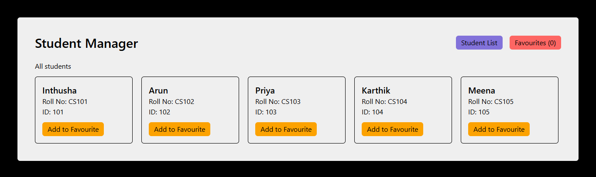
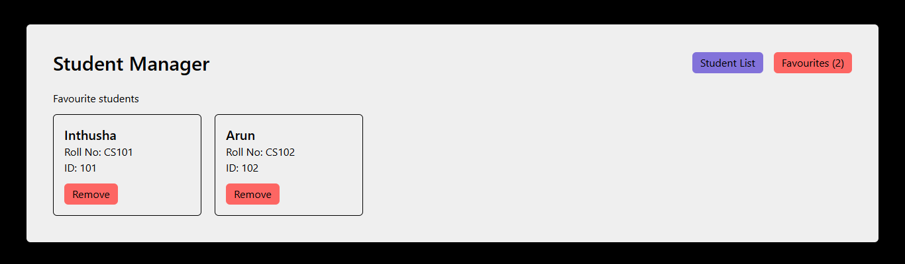

# ⭐ Favourite Student List – React Student Management App

Favourite Student List is a simple and interactive web application built using React, React Router, Context API, and Tailwind CSS. It allows users to browse a list of students, add them to a favourites list with a single click, and remove them when they are no longer needed. The favourites list is shared across all pages using global state.

## 🌐 Live Demo

🔗 [View Live Demo](https://favourite-student-list-self.vercel.app/)

## 📸 Screenshots

### 🖥️ Student List Page



### ⭐ Favourites Page



## ✨ Features

* 📋 **Student Display:** Displays students with their name, roll number, and ID.
* ⭐ **Add to Favourite:** Allows users to add any student to the favourites list with one click.
* 🚫 **Duplicate Prevention:** Prevents the same student from being added twice. The button changes to "Added" and is disabled.
* 🗑️ **Remove Favourites:** Allows users to remove individual students from the favourites list.
* 🔀 **Multi-Page Navigation:** Moves between the Student List and Favourites pages without a page reload.
* 🔢 **Live Counter:** Shows the number of favourite students in the navigation bar and updates it instantly.
* 💬 **Status Messages:** Shows a message when a student is added or already exists in favourites.
* 📭 **Empty State:** Displays "No favourite students added yet" when the favourites list is empty.
* 🌍 **Global State:** Shares favourites across all pages using the Context API.
* 🎨 **Clean User Interface:** Uses simple, responsive styling built with Tailwind CSS.

## 🛠️ Technologies Used

* React JS
* React Router DOM
* Context API (`createContext`, `useContext`)
* React Hooks (`useState`)
* Tailwind CSS
* JavaScript (ES6)

## 📂 Project Structure

```
favourite-student-list/
│
├── public/
├── screenshots/
│   ├── student-list.png
│   └── favourites.png
├── src/
│   ├── context/
│   │   └── StudentContext.js
│   ├── components/
│   │   └── Navbar.js
│   ├── pages/
│   │   ├── StudentList.js
│   │   └── Favourites.js
│   ├── App.js
│   ├── index.js
│   └── index.css
├── package.json
└── README.md
```

## 🚀 How to Run Locally

1. Clone the repository:

```
git clone https://github.com/inthusha20241647-commits/favourite-student-list.git
```

2. Open the project folder in VS Code.
3. Install the dependencies:

```
npm install
```

4. Start the development server:

```
npm start
```

5. Open `http://localhost:3000` in your browser.

## 📖 How It Works

### Add a Student to Favourites

1. Open the **Student List** page.
2. Click the **Add to Favourite** button on any student card.
3. A message confirms the student was added.
4. The button changes to **Added**, and the favourites counter increases.

### View Favourites

Click **Favourites** in the navigation bar to see all the students you have added.

### Remove a Student from Favourites

Click the **Remove** button on any student card in the Favourites page to remove that student from the list.

### Empty List

If no students have been added, the Favourites page displays: *"No favourite students added yet"*.

## 🎯 Learning Objectives

* Understand React functional components and hooks.
* Practise client-side routing with React Router and the `<Link>` component.
* Learn global state management using `createContext` and `useContext`.
* Understand the Provider pattern and how `children` are passed.
* Display dynamic lists using the `map()` method.
* Prevent duplicates and remove items using `some()` and `filter()`.
* Update state without mutating it using the spread operator.
* Use conditional rendering to show different UI based on state.
* Style a responsive interface using Tailwind CSS.

Favourite Student List is a frontend development project created as part of my continuous learning journey.
